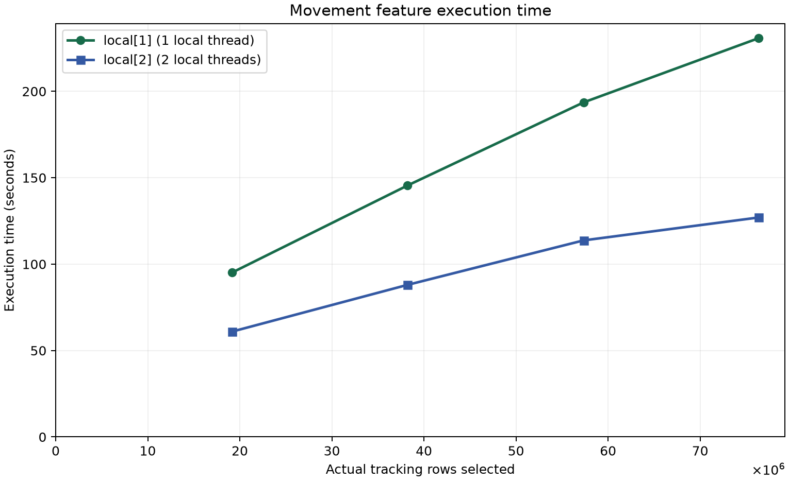

# Adolfo's Part 2 timing report draft

Status: the eight measured configurations are complete and reconciled with MySQL.
The final timing table and graph are ready for Adolfo's review and insertion into
the shared report. PR #5 remains a draft. Joshua's final movement-table publishing
is still pending and is a separate team task.

## Timing method and implementation

Adolfo ran the required matrix on `class-146` in conda environment `cs179`, from
`/home/cs179g/Pivot-adolfo-timing`. **The measured code version is
`fd9d641f14e7ff5a0b47e05d1de93a40c2a4dd11`**. Later documentation, evidence-review
and plotting commits are not the version measured on the server. Suite
`c02d1a57-1df9-41b3-b867-e4a5694b7499` ran from
`2026-11-16T04:52:49Z` to `05:16:33Z` (November 15, 2026,
8:52:49-9:16:33 p.m. PST). The suite window includes startup, validation and
inserts; it is not the sum of the measured transformation intervals.

`part2_spark/run_timing.py` launched eight fresh `spark-submit` processes in order:
25%, 50%, 75%, 100%, with `local[1]` followed by `local[2]` at every fraction.
These settings mean one and two **local execution threads**, not separate worker
processes or a multi-machine cluster. The shared MySQL field is named `workers`;
that column name does not change the execution model.

`benchmark_movement.py` selects complete PlayKey trajectories using
`pmod(xxhash64(179, cast(PlayKey as string)), 1000000)` and thresholds 250000,
500000 and 750000. The 100% case includes all tracking rows. Hash fractions refer
to play-key buckets, not exact row percentages: actual tracking-row fractions
were approximately 25.079%, 50.057%, 75.081% and 100%. Both thread counts use the
same deterministic subset at each size. The selected tracking frame is passed to
`movement_adapter.py`, which calls the import-safe `build_features` function in
Joshua's `02_movement_features.py`. The normal full job calls that same function.
The refactor preserved his movement formulas, event boundaries, joins and output
columns; it did not copy those calculations into another implementation.

The monotonic `time.perf_counter()` interval in `benchmark_movement.py` begins
**after Spark session startup, immediately before reading the three cleaned
Parquet datasets**, and ends **after both complete output DataFrames have been
written as isolated Parquet outputs**. It includes input reads, complete-play
selection, feature/summary transformations, plan construction/schema checks, and
full-column Parquet materialization. Writing every output column forces real
movement computation rather than timing only lazy plan construction. The two
output plans can recompute common work; that cost is included consistently.
Neither the driver nor the shared transformations persist DataFrames for these
measurements, and each configuration runs in a fresh process.

Excluded: Python/JVM/package startup, Spark session startup, initial input-file
metadata collection, post-write validation/counting/fingerprinting, and appending
the timing record to MySQL. Spark session startup was separately recorded at
4.056-4.325 seconds per run. **These timings include isolated Parquet output and
exclude final analysis-table JDBC publishing.** After validation, the shared
`common.write_table` helper appended one row to `timing_results` using explicit
`mode="append"`; benchmark execution did not publish final analysis tables.

Recorded server versions/settings: Python 3.11.17, Spark 4.2.0, Java
17.0.18-internal, MySQL 5.7.20 on TCP port 3307, Connector/J 8.4.0, 200 shuffle
partitions and adaptive execution enabled. Default parallelism was respectively
1 and 2; the other recorded settings matched throughout. Driver/executor memory
and session timezone were recorded as `unset`, so no explicit memory allocation
is inferred from them. Exact JVM options are retained in the JSON evidence.
The input manifest covered 72 files totaling 755,324,331 bytes across the three
datasets; that is not a measured per-fraction physical file size.

## Measured evaluation table and graph

Each cell is one measured trial. Seconds and ratios below are rounded to three
decimals; the archived JSON/CSV preserves full precision. Retained/excluded counts
match across the two thread counts, so each fraction has one shared count row.
`T1/T2` is the observed ratio of one-thread time to two-thread time.

| Fraction | Actual tracking rows | Selected plays | Retained plays | Excluded plays | local[1] (s) | local[2] (s) | T1/T2 |
|---|---:|---:|---:|---:|---:|---:|---:|
| 25% | 19,151,759 | 66,780 | 63,864 | 2,916 | 95.105 | 60.950 | 1.560 |
| 50% | 38,227,233 | 133,604 | 127,722 | 5,882 | 145.545 | 88.018 | 1.654 |
| 75% | 57,336,744 | 200,541 | 191,761 | 8,780 | 193.595 | 113.734 | 1.702 |
| 100% | 76,366,748 | 266,960 | 255,329 | 11,631 | 230.793 | 127.003 | 1.817 |



Figure 1. Movement-feature computation plus isolated Parquet output at measured
commit `fd9d641`. The horizontal axis gives actual selected tracking rows (in
millions); the vertical axis gives elapsed seconds. The legend identifies local
execution threads. Lines connect the four observed points for each setting;
there are no repeated-trial averages or error bars.

Use the original [PNG](evidence/part2-adolfo/measured-20261116T045249Z/report/timing_plot.png)
or [SVG](evidence/part2-adolfo/measured-20261116T045249Z/report/timing_plot.svg)
in the shared report. The [generated Markdown table](evidence/part2-adolfo/measured-20261116T045249Z/report/timing_table.md)
and [CSV](evidence/part2-adolfo/measured-20261116T045249Z/report/timing_table.csv)
come from the existing `plot_timing.py`, without fixture/partial-result options.
The graph was visually inspected locally for complete axes, readable legend,
correct units and all eight measured points. Its postprocessing environment is
recorded separately and is not the measured server environment.

## Discussion of observed scaling

Two local threads reduced elapsed time at every measured size. The observed
ratios T1/T2 were 1.560, 1.654, 1.702 and 1.817 as the selected workload increased.
Relative time reductions were 35.9%, 39.5%, 41.3% and 45.0%, respectively. At full
size, 230.793 seconds fell to 127.003 seconds, a reduction of 103.790 seconds.
This supports an observed benefit from two local threads for this job and suite;
it does not establish distributed-cluster scaling or repeatable statistical gains.

Selected tracking rows increased by about 3.99 times between the smallest and
full workload, while elapsed time increased by about 2.43 times for one thread
and 2.08 times for two threads. Both curves rose monotonically, and the observed
thread benefit increased with workload. Fixed work, full-source scans and
scheduling/output costs are plausible contributors to the less-than-proportional
time growth; no CPU, disk, cache or concurrent-load profiling was collected to
identify a specific bottleneck.

The interpretation has several limits. There was one trial per configuration,
so variance and confidence intervals cannot be estimated. Execution order was
fixed, with the one-thread run first at each size, and fractions increased in
order. The smoke test, fixture tests, preceding benchmarks and validation scans
could warm filesystem/OS caches; no shared caches were cleared. Fresh Spark
processes prevent persisted DataFrames from carrying over, but do not remove
those OS cache effects. Other activity on the shared server could affect timings;
its load was not continuously measured or controlled.

Hash filtering may still scan the full source Parquet files at every fraction.
No smaller physical datasets were created or verified. Consequently these
results scale selected computation/output rows, not guaranteed reduced source
I/O, and the measured 25% configuration is not a quarter-size file read. The
boundary also includes isolated Parquet output and possible common-plan
recomputation, while excluding startup, validation and timing JDBC insertion.
A 1.817 ratio therefore describes this particular boundary, not production MySQL
publishing time or a universal speedup for Spark workloads.

## Correctness, provenance and MySQL verification

All eight summary records and per-run `result.json` files report `success`,
`phase="complete"`, `appended=true`, and process exit code 0. Per-run commands
request the intended master, fraction, seed, Connector/J package and
`--record-timing`. Worker startup markers, command timestamps and completion
times establish the sequential order. The final JSON log summaries agree with
the result records. All nine recorded Python source hashes match Git blobs at
`fd9d641`, and every run records a clean checkout at that commit.

Within each thread pair, selected-row counts, selected PlayKeys, full-row
fingerprint sums, retained/excluded counts and summary row counts match. Input
metadata hashes, source hashes, host, Spark version and common recorded settings
also match across the suite. The order-independent fingerprint is a consistency
check, not a cryptographic proof of identical rows. Input metadata SHA-256 is
`c84d3e7f924201142a5ac3aecead30f0cf7ff31600c4d8336ddea3c0bb8d79af`.

The measured driver validates saved outputs for unique/non-null primary keys,
required non-null metadata, membership in the selected tracking keys, and exact
per-surface/position count agreement between `movement_summary` and
`play_features`. Every run produced 20 summary groups. At full size both runs
retained **255,329 plays** from 266,960 selected keys, excluding 11,631 (4.36%).
This matches Joshua's reported full-data output count. It is a comparison on this
dataset, not a universal expected count or independent proof of every feature's
numerical correctness. Exclusions combine boundary/metadata effects, without a
per-reason breakdown. Raw Parquet outputs remain outside the committed archive;
local review reconciled evidence rather than recomputing the dataset.

The [MySQL export](evidence/part2-adolfo/measured-20261116T045249Z/mysql-verification.txt)
contains eight distinct timing rows, IDs 1-8. In configuration order each row
matches the worker's thread count, fraction, actual tracking-row count and
full-precision seconds. Interpreting the export's unzoned timestamps as PST
places each insert inside its recorded validation-to-completion window. This
confirms an exported timing row for every successful measurement, without
retries or duplicate matching rows in this export. The shared table has no
experiment ID; these matches use values and append windows and do not assert
that the shared database will always contain exactly eight rows.

The same export shows **`play_features=0` and `movement_summary=0`**. Before the
smoke these tables were also empty. These are observed checkpoints, not
continuous table auditing. The 255,329 feature rows are isolated benchmark
outputs, not published MySQL analysis rows. **Joshua's full-data MySQL publishing
remains a separate pending team task.** No such publishing was performed by
Adolfo's benchmark or the local assistant. Team coordination must preserve the
timing rows and unrelated results; no schema recreation or table replacement is
part of this report work.

## Correctness fixtures and earlier smoke (separate evidence)

Adolfo confirmed that the opt-in server tests completed before the measured
suite: 22 tests ran, OK, with one skip because Matplotlib was missing (21 passed).
Those synthetic tests cover valid/excluded boundaries, metadata filtering, known
feature values, schemas, validation failures, shared-function delegation, import
safety and cleanup/repeated calls. This test result is user-reported; the
transferred measured archive does not include its terminal log. Local plotting
and logic checks are recorded separately from server execution: the plotting
virtual environment ran all 22 tests, with 21 passing (including graph rendering)
and the server-only Spark fixture skipped. Evidence reconciliation and report-link
checks also passed locally; none of these local checks are performance trials.

The earlier 1%/local[1] smoke suite at `2026-11-16T04:47:39Z` selected 778,421
tracking rows and 2,772 keys, retained 2,658 plays, excluded 114 and produced 20
summary groups. Its boundary took 45.239 seconds and `appended=false`; database
counts were 0/0/0 before and after. That diagnostic observation is excluded from
the measured table, graph and eight MySQL rows. Fixture previews are synthetic
and are also excluded. Prior MySQL recovery used the existing installation/data
directory, as reported by Adolfo; infrastructure recovery was not a benchmark
operation.

## Adolfo's contribution

Adolfo Magallanes implemented the Part 2 timing runner, deterministic complete-play
sampling, evidence/provenance checks, output validation and plotting tools. He
integrated Joshua's movement calculations through one import-safe shared function
and a real benchmark adapter, preserving the calculations and normal full-job
entry point. He ran the correctness checks, smoke and eight required configurations
on class-146, appended the validated timings to MySQL, reconciled the exported
rows, and prepared the measured table, graph and scaling discussion. Local
postprocessing used a plotting-only virtual environment; Spark and MySQL were
not installed locally for this work. Moses owns infrastructure/H1, Joshua owns
the movement calculations and pending final publishing, and Colin owns the
nflverse analysis. This contribution does not claim teammates' calculations or
completion of the final movement-table publishing.

## Exact shared-report and screenshot handoff

The shared report has not been edited. Add only Adolfo's timing material:

1. Under the shared report's Part 2 implementation section, insert the method and
   script descriptions from **Timing method and implementation** above. Include
   measured commit `fd9d641`, the timer boundary and the local-thread definition.
2. Under evaluation, insert the eight-configuration table from **Measured
   evaluation table and graph**, Figure 1 using the original PNG/SVG, and its
   caption. Keep the selected/retained/excluded counts and T1/T2 definition. Copy
   **Discussion of observed scaling** with its limitations; do not substitute the
   smoke or fixture values or describe the lines as averaged trials.
3. Add the correctness/MySQL verification paragraph and link the curated evidence
   directory. Put **Adolfo's contribution** into the contribution section. Preserve
   teammates' sections. Flag Joshua's final MySQL publishing in the team's pending
   work rather than marking it complete.
4. Capture a terminal evidence screenshot using the read-only commands below.
   Keep the pinned commit, suite ID, suite status and all eight result lines
   visible. Caption: "Required timing suite at fd9d641; all eight configurations
   succeeded and appended, with actual selected rows and retained play counts."

**SSH SERVER - read-only measurement screenshot; do not rerun the benchmark:**

```bash
cd /home/cs179g/Pivot-adolfo-timing
git rev-parse HEAD
python - <<'PY'
import json
from pathlib import Path
p = Path('/home/cs179g/pivot_timing/measured-20261116T045249Z/summary.json')
s = json.loads(p.read_text())
print('suite:', s['suite_id'], 'status:', s['status'])
print('measured commit:', s['code']['git_commit'])
print('master fraction tracking_rows selected retained seconds status appended')
for r in s['runs']:
    print(r['master'], r['data_fraction'], r['rows_processed'], r['selected_plays'],
          r['retained_output_plays'], f"{r['seconds']:.3f}", r['status'], r['appended'])
PY
```

5. Capture a separate MySQL screenshot showing the query and all eight rows,
   plus final-table counts. Caption: "Timing rows 1-8 match the archived suite;
   final movement-table counts are shown separately." Run only the read-only
   query below. If Joshua has since published the analysis tables, report that
   later state separately from the archived zero counts; do not alter any tables
   to reproduce a screenshot.

**SSH SERVER - read-only MySQL screenshot:**

```bash
mysql -h 127.0.0.1 -P 3307 -u root pivot -t -vv -e '
SELECT run_id, workers, data_fraction, rows_processed, seconds, run_at
FROM timing_results WHERE run_id BETWEEN 1 AND 8 ORDER BY run_id;
SELECT COUNT(*) AS play_features_rows FROM play_features;
SELECT COUNT(*) AS movement_summary_rows FROM movement_summary;'
```

6. Insert `docs/evidence/part2-adolfo/measured-20261116T045249Z/report/timing_plot.png`
   directly in the report, uncropped. If a separate graph screenshot is required,
   open that PNG locally and capture the entire title, both axes (including the
   x-axis multiplier), all eight points and the thread legend. Do not capture the
   fixture-preview graph. The PNG itself is preferable for report readability.
7. If an implementation screenshot is required, show `movement_adapter.py` calling
   the shared `build_features`, then `benchmark_movement.py` lines 214-232 at the
   measured commit for the timer/read/full-column-write boundary. Lines 122-136
   show the explicit timing-row schema and append helper. Caption the measured
   code version, not the later report commit. Add these screenshots to Adolfo's
   section without replacing teammates' evidence.

The remaining human steps are graph/report review, screenshot capture and shared
report insertion. Keep PR #5 as a draft until that review is complete; do not merge
it or update the pinned server checkout as part of this handoff.
